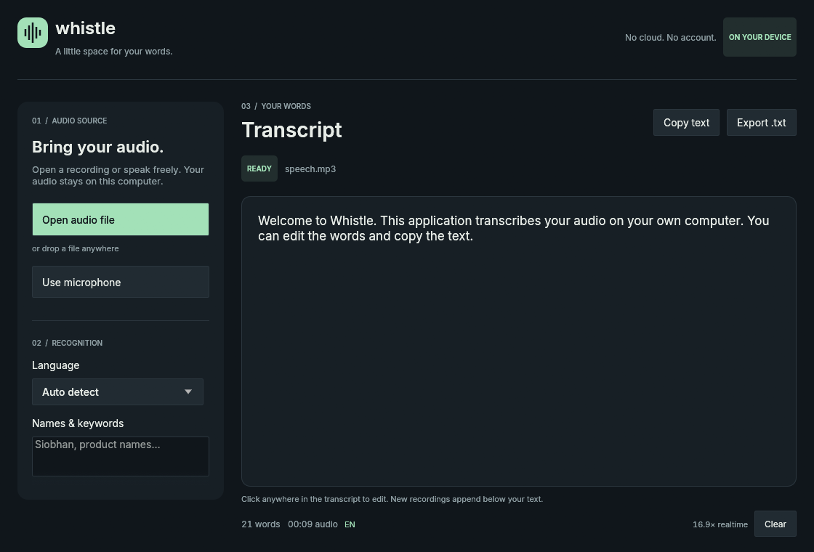

# Whistle Desktop

[](https://github.com/Prit36/whistle-desktop/actions/workflows/ci.yml)
[](https://github.com/Prit36/whistle-desktop/releases/latest)

A native Rust app for private, offline speech to text. Import or drop an MP3, WAV, FLAC, OGG/Vorbis, M4A/AAC or AAC recording, or use your default microphone. Edit confirmed words, copy the transcript, undo clearing it, and export UTF-8 text.

In the portable bundle, double-click `Whistle.exe`. In this source checkout, the release is in `dist/Whistle/Whistle.exe`, or launch it through `START-WHISTLE.cmd` after packaging. Keep the adjacent `runtime` directory with the executable. A prepared bundle needs **no internet, API key, Python, FFmpeg or model download** to run.

**[Download the latest Windows x64 release](https://github.com/Prit36/whistle-desktop/releases/latest)**. Extract the ZIP and open `Whistle/Whistle.exe`. The Windows binary is unsigned. Check the accompanying `SHA256SUMS.txt` to verify the download.



This is an independent desktop client, not an official Cactus Compute product. Live microphone input is implemented, but real microphone hardware was unavailable on the development host. Text appears after pauses, with a maximum six-second audio segment plus inference time. See [validation](VALIDATION.md) for the tested scope.

## Build and run

Requires Rust 1.98.1 (pinned in `rust-toolchain.toml`), Python 3.11+ for setup/packaging, and the native toolchain for your OS. On Windows, use the MSVC Rust toolchain with Visual Studio C++ Build Tools. Linux also requires ALSA development headers, a C compiler, and a desktop with OpenGL and a file-dialog portal. macOS requires the Xcode command-line tools.

```powershell
git clone https://github.com/Prit36/whistle-desktop.git
cd whistle-desktop
python scripts/setup_runtime.py
cargo run --release --bin whistle-desktop
```

Setup uses Python's standard library only. It downloads a pinned Whistle model and the native Needle library from the publisher's wheel, verifies SHA-256 hashes, and extracts **only the native library**. No Python package is installed. App startup makes no network request. To prepare an air-gapped machine, run setup elsewhere and copy the complete `runtime` directory.

```powershell
python scripts/package.py --skip-downloads
```

This builds both executables, copies the approved runtime and third-party notices, and writes `dist/Whistle-0.1.0-windows-x64.zip` and `dist/SHA256SUMS.txt`. Omit `--skip-downloads` to prepare the runtime first. Dependencies are locked in `Cargo.lock`; Fastframe and its recommended egui/winit forks are pinned together. Update revisions and the runtime manifest deliberately, then rerun validation. Public release builds require a clean tagged checkout; see [RELEASING.md](RELEASING.md).

## Use

- **Open audio file** or drop a recording onto the window. A new source appends below existing text.
- **Use microphone** captures your OS default input device. Phrases become editable after pauses (about 500 ms of quiet). Continuous speech is split into segments of at most six seconds, followed by inference time. **Stop recording** drains captured audio and transcribes the final phrase.
- Choose automatic language detection or English, German, French, Spanish, Italian, Dutch, or Polish. Whistle currently supports these seven languages; Hindi is not supported by this model.
- Add names and keywords separated by commas or newlines before starting a source.
- Click the transcript to edit or select text. **Copy text** copies confirmed, edited text. **Export .txt** saves a snapshot through Fastframe's atomic file writer.
- **Clear** has an **Undo clear** action. Audio and transcript stay in memory until you export text or close the app.

| Shortcut | Action |
| --- | --- |
| Ctrl+O | Open audio |
| Ctrl+Enter | Start microphone / stop current job |
| Ctrl+Shift+C | Copy entire transcript |
| Ctrl+S | Export text |
| Ctrl+C / Ctrl+V / Ctrl+Z | Normal editor selection, paste and undo |

You can also open a file from the command line: `Whistle.exe recording.mp3`. Set `WHISTLE_RUNTIME_DIR` to an explicit runtime directory if needed.

## Performance design

- Native Rust UI with **Fastframe fonts, platform text rendering and atomic files**, using egui/eframe's lightweight OpenGL renderer. No webview or browser runtime.
- A single inference worker owns the native, process-global Whistle C API. The Rust wrapper enforces exclusive engine ownership and is neither `Send` nor `Sync`.
- The model loads once from a read-only memory map. A fixed JSON output buffer is reused.
- Symphonia decodes files packet by packet. A persistent Rubato SIMD sinc resampler converts mixed mono audio to 16 kHz, removes startup delay and flushes the exact final sample count.
- File inference uses at most 12 seconds of PCM (768 KB), split at pauses or the quietest boundary in the final second. Each sample is transcribed once; there is no overlap that could duplicate text at a seam. Audio continuity is tested independently of the model's recognition accuracy.
- Live capture downmixes into a lock-free, fixed-size SPSC ring. The callback allocates nothing, takes no locks and performs no inference. Resampling and pause-aware transcription run on the worker. Live phrases hold at most six seconds of PCM (384 KB). The ring holds 10 seconds at the microphone's native rate; overrun stops capture with an explicit error.
- Worker notifications are bounded to eight events. The UI repaints on changes; the live level meter updates at 20 Hz. No idle animation loop.
- The transcript is limited to 4 MB of UTF-8. The editor permits up to one million manually entered characters. Copy/export takes one additional text snapshot. Audio buffers stay bounded as a file grows; transcript and editor undo history account for growing text memory.

Cancellation is cooperative: a native inference pass must finish before cancellation takes effect. Current confirmed text is preserved; untranscribed file audio is discarded on cancel. Recognition accuracy and realtime performance depend on the source and hardware. Forced boundaries in speech with no pauses can split a word. See `VALIDATION.md` for actual measurements and tested limits.

## Validate

```powershell
cargo fmt --check
cargo clippy --all-targets -- -D warnings
cargo test --all-targets
cargo test --test native_engine -- --ignored
cargo build --release --bins
.\target\release\whistle-cli.exe recording.mp3 en
.\target\release\whistle-cli.exe recording.mp3 en --live
.\target\release\whistle-cli.exe --check-microphone
```

The ordinary tests require no model. The ignored native test requires setup. `--live` feeds a file through the same phrase pipeline as the microphone, without real-time pacing. `--stream` is a diagnostic for the vendor's native streaming API; it was slower than realtime in the Windows test and is not used by the app. `--check-microphone` opens the default input for 250 ms, verifies samples arrived, and stores no audio. Render QA: `whistle-desktop.exe --screenshot preview.png`, or `whistle-desktop.exe recording.mp3 --screenshot preview.png` to capture a completed transcript and exit.

Initial release target: Windows x64. Setup supports the publisher's Windows ARM64, macOS ARM64/x64 and Linux glibc/musl x64/ARM64 libraries through `--tag`; other hosts still require native builds and testing. Protected media, unusual codecs and damaged packets report errors.

## Upstream sources

- [Whistle release and model information](https://cactuscompute.com/blog/whistle)
- [Whistle weights](https://huggingface.co/Cactus-Compute/whistle)
- [Needle native runtime](https://huggingface.co/Cactus-Compute/needle3)
- [Needle's public ABI wrapper](https://github.com/cactus-compute/needle/blob/3da4261073199444f2e070800854436fbc31fb6a/needle/agent/whistle.py)
- [Fastframe](https://github.com/crmne/fastframe/tree/b3cb8d04a75c2212aed4e9f950f0e0fdd5208a39)

Whistle/Needle weights and runtime use Apache-2.0. Fastframe uses MIT; its bundled Inter font uses SIL OFL 1.1. Packaging includes source dependency license files and the publisher's runtime licenses. This project uses MIT.
